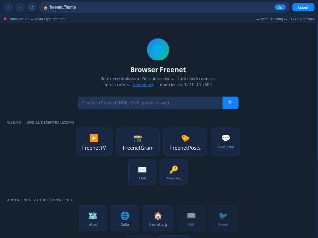
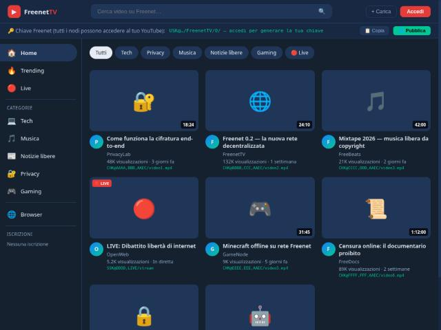
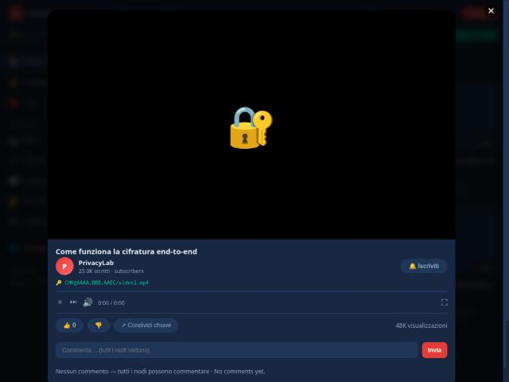
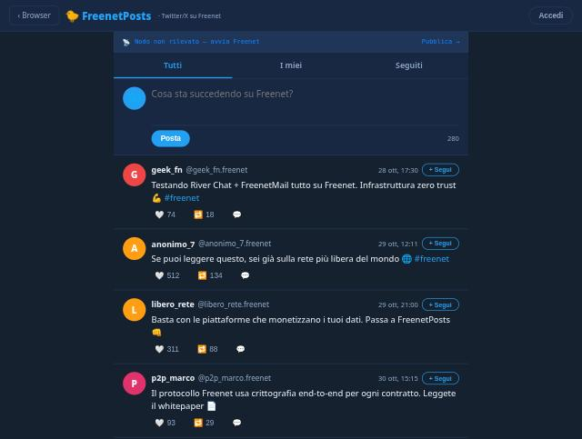
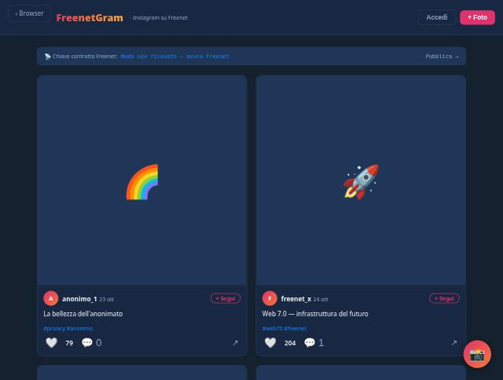

# Web 7.0 — Social Decentralizzato su Freenet
## Decentralized Social on Freenet

**IT:** Rete sociale completamente decentralizzata basata su [Freenet](https://freenet.org) (peer-to-peer). Nessun server centrale, nessuna email, nessun tracciamento. Solo nome utente e password.

**EN:** Fully decentralized social network built on [Freenet](https://freenet.org) (peer-to-peer). No central server, no email, no tracking. Username and password only.

---

## Screenshot

<table>
<tr>
<td align="center"><br><b>Browser Freenet</b></td>
<td align="center"><br><b>FreenetTV</b></td>
</tr>
<tr>
<td align="center"><br><b>FreenetTV — Player + Iscrivi</b></td>
<td align="center"><br><b>FreenetPosts</b></td>
</tr>
<tr>
<td align="center" colspan="2"><br><b>FreenetGram</b></td>
</tr>
</table>

---

## App / Apps

| App | Descrizione (IT) | Description (EN) | URL Freenet |
|-----|-----------------|------------------|-------------|
| 🌐 **Browser Freenet** | Browser per la rete Freenet con archivio siti | Freenet browser with site archive | `/v1/contract/web/browser-fn/` |
| 📺 **FreenetTV** | YouTube decentralizzato — video, like, commenti | Decentralized YouTube — video, likes, comments | `/v1/contract/web/fresnettv/` |
| 📷 **FreenetGram** | Instagram decentralizzato — foto, hashtag | Decentralized Instagram — photos, hashtags | `/v1/contract/web/frenetgram/` |
| 📝 **FreenetPosts** | Twitter/X decentralizzato — post 280 caratteri | Decentralized Twitter/X — 280 char posts | `/v1/contract/web/freenetposts/` |

---

## Accesso / Access

**IT:**
- Solo **nome utente + password** — nessuna email richiesta
- Nessun tracciamento, nessun algoritmo, nessun ban
- Tutti i dati salvati in locale (localStorage) sul tuo dispositivo
- Pubblicato sulla rete Freenet P2P — permanente e non censurabile

**EN:**
- **Username + password only** — no email required
- No tracking, no algorithm, no bans
- All data saved locally (localStorage) on your device
- Published on Freenet P2P network — permanent and uncensorable

---

## Installazione / Installation

### Linux (un click / one click)
```bash
curl -sSL https://raw.githubusercontent.com/blue-terminal/web70-core/main/install.sh | bash
```

### Windows (PowerShell)
```powershell
iwr -useb https://raw.githubusercontent.com/blue-terminal/web70-core/main/install.ps1 | iex
```

### Debian / Ubuntu
```bash
sudo dpkg -i web70_1.0.0_all.deb
web70-install
```

### Android
Scarica l'APK da / Download APK from:
[github.com/blue-terminal/freenet-android/releases/latest](https://github.com/blue-terminal/freenet-android/releases/latest)

---

## Protocollo Freenet / Freenet Protocol

| Endpoint | IT | EN |
|----------|----|----|
| `GET /v1/version` | Versione nodo | Node version |
| `GET /v1/contract/web/{key}/` | Serve l'app web | Serves the web app |
| `WS /v1/contract/command?encodingProtocol=native` | WebSocket contratti | Contract WebSocket |

Nodo locale / Local node: `http://127.0.0.1:7509`

---

## Ecosistema Freenet / Freenet Ecosystem

Basato sull'ecosistema reale di [github.com/freenet](https://github.com/freenet).  
Built on the real ecosystem at [github.com/freenet](https://github.com/freenet).

| Chiave contratto / Contract Key | App |
|--------------------------------|-----|
| `771DvtPMwt2PumPyrFvsz7fpvU1gogcmb5qtS1yYEEH9` | Atlas (search) |
| `raAqMhMG7KUpXBU2SxgCQ3Vh4PYjttxdSWd9ftV7RLv` | River Chat |
| `122f6AR7PyF8d8mhczuNQM4xrLtBf5t8g2iB7PEVT7KC` | Freenet Mail |
| `EqJ5YpEEV3XLqEvKWLQHFhGAac2qXzSUoE6k2zbdnXBr` | Delta (site builder) |

---

## Repository / Repositories

| Repo | Descrizione / Description |
|------|---------------------------|
| [blue-terminal/web.7.0](https://github.com/blue-terminal/web.7.0) | App Web 7.0 (questo repo / this repo) |
| [blue-terminal/web70-core](https://github.com/blue-terminal/web70-core) | Fork freenet-core + Web 7.0 integrato |
| [blue-terminal/freenet-android](https://github.com/blue-terminal/freenet-android) | App Android con pulsante Web 7.0 |

---

## Licenza / License

**MIT License** © 2026 blue-terminal

Libero per tutti / Free for everyone — open source, nessun tracciamento, nessuna email.  
No tracking, no email, no central server. Peer-to-peer only.
